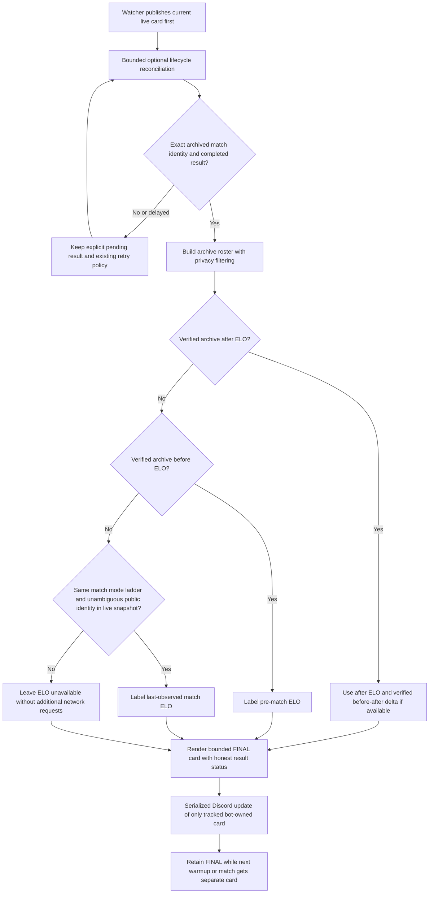

# Slipgate FINAL results

## Display contract

- Confirmed completed results have a gold accent, `🏁 FINAL MATCH RESULTS` heading, winning team (or draw), explicit Red/Blue scoreline, actual archive duration/end time, rated/unrated status when reported, and highest **reported public** score. Aborted matches do not declare a winner. Pending results remain amber and explicitly describe last-observed—not confirmed final—statistics.
- Keep full-width Red / VS / Blue roster sections. Spectators stay separate; no alive/dead markers or live win prediction on finals. Preserve source-derived score/K/D columns.
- Clan Arena ELO precedence: archive `display_after`; otherwise archive `display_before` marked `† pre-match`; otherwise last-observed live ELO from the exact match, mode, ladder and public Steam ID marked `‡`. Never join by nickname, use another match/ladder, expose private identity, or query extra profiles to fill a historical gap. Ambiguous cached identities cannot provide a fallback.
- Display `Δ` only for a safe-integer archive before/after pair, computed from those actual values. A cached/pre-match ELO is not a confirmed final rating or rating change. If ELO is genuinely unavailable, explain it once rather than inventing values.
- Source time is the archive end time; confirmation time is the actual archive check time, not the earlier live fetch. Preserve existing confirmed FINAL messages when another match starts.

## Normal operation

### Actors, evidence and boundaries

- **User:** authorizes the bot watch; the normal command remains `!quakestats purgery` (or another configured server).
- **Watcher/lifecycle:** existing provider gate, cadence, bounded retries and live-first publication are unchanged. Archive identity/server/mode/ladder/end time must be validated before accepting a final. No new provider requests are introduced by presentation or rating fallback.
- **Renderer:** consumes validated snapshots; escapes hostile text and bounds Discord fields. Public scoreboard metrics are not proof of a player's overall performance; the highlight is deliberately called highest reported score, not MVP.
- **Discord writer:** existing serialized edit/post path is the side-effect boundary. Never modify human messages or unrelated cards; retain final results.
- **Operator:** deploys only after tests/review and explicit deployment approval. Restart clears the in-memory watch; installing code is not proof that a new live match boundary has occurred.

## Validation and observed state

`tests/unit/finalScoreboardDetails.test.js` covers rating precedence, signed/zero deltas, absent ELO, unknown/wrong ladders, exact identity and ambiguity, private players, final hierarchy, aborted/tied/missing scores, confirmation timestamps and hostile Unicode/large-roster Discord limits. Existing lifecycle, live-first, renderer/client and security tests remain required.

The chart describes installed code capability, not a claim that a particular production match transition was observed. Keep deployment/health evidence and exact live-card readbacks outside the repository; do not include credentials or unlabelled synthetic match examples in operator reports.
