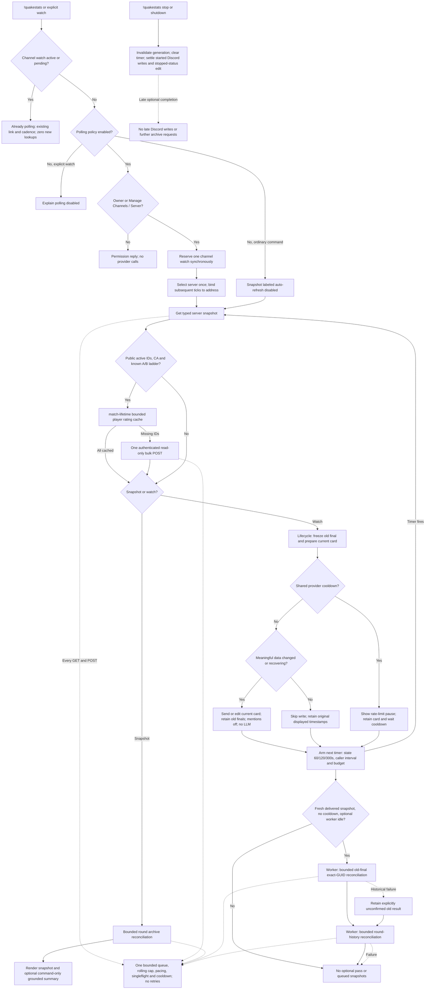
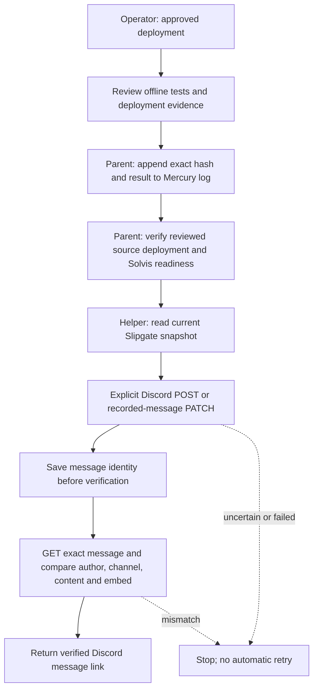

# Slipgate scoreboards and tracking

`!quakestats [server]` starts one auto-updating scoreboard card when polling is enabled. An address (`host:port`, including bracketed IPv6) selects that server directly; a name substring filters OCE discovery, and no filter chooses the most populated OCE server (including an empty one). `!quakestats watch [server]` remains an explicit alias for starting a watch. `!quakestats stop` stops it and acknowledges only after an in-flight Discord write and the final stopped-status edit settle. The status edit retains the displayed source/fetched timestamps. Restart stops all in-memory watches; run the command again to subscribe.

Starting or stopping a subscription requires the invoking member’s actual **Manage Channels** or **Manage Server** permission, or the configured bot owner’s exact Discord ID. Channel, guild, block and rate gates still apply. Ordinary chat keeps its existing routing and FIFO handling; watch timers never own the conversational lock. A duplicate command checks the channel reservation synchronously before discovery, archive, ratings or analysis work. It replies **already polling**, with the existing card link when available and the minimum cadence; it creates no lookup, model request, timer or card. This also covers concurrent initial commands and changed filters. Stop before changing the tracked server.

With polling disabled, ordinary `!quakestats` explicitly labels its reply as a snapshot with auto-refresh disabled. `!quakestats snapshot [server]` requests a one-time view when there is no active channel watch. Snapshot mode retains the optional command-only grounded analysis. Watch ticks are deterministic and never invoke an LLM.

## Normal operation

The request outline is discovery (when necessary), one server detail with any permitted ratings enrichment, then **publish the current watch view before optional historical work**. Snapshot-only commands still await their bounded round reconciliation. Watch ticks bind to the initially selected address. They never reselect a different server when it empties. All entry points, including legacy `!serverstats`, conversational Quake lookup, and temporary `forceRefresh` requests, use the same default Slipgate client. Slipgate is the sole live/team/player source; empty results or outages do not fall back to another provider or use legacy name-based player enrichment. Optional authenticated ratings use only validated public SteamID64 values from that snapshot.

### Live-first watch outline

- Admission and ownership: reserve the authorized channel watch; the lifecycle freezes and retains an old FINAL before preparing the next warmup/match card. It does not wait for an archive lookup to publish the current view.
- Current work: fetch one current snapshot, render/send/edit if needed, and arm the next ordinary live timer. Existing Discord writes serialize, including optional edits to retained results.
- Optional work: after current delivery and timer scheduling, start at most one non-awaited pass per watch: first bounded retained-final confirmation, then bounded round-history reconciliation. A busy worker causes optional passes to be skipped, not accumulated. Unchanged fresh snapshots still permit maintenance; stale snapshots and active provider cooldowns do not start it.
- Verification/output: an old archive can confirm only its exact old FINAL; it cannot replace the new match card. A warmup card promotes in place when its new live GUID arrives. Archive failures leave explicit provisional results and do not consume the current watch's transport failure budget.
- Failure/stop: current transport retains its existing backoff/stop rules. Stop invalidates optional writes and subsequent archive calls, but an already-started provider operation can still complete. No extra maintenance polling timer, increased budget, network retry or automatic model call is introduced.

Optional work still shares the existing provider request queue, cap and cooldown with live fetches; it cannot preempt an already-started request, and these cadence floors are not exact end-to-end wall-clock guarantees. The behavioral regressions are `tests/unit/quakeLiveFirst.test.js` (deferred real round history, pending final archive through warmup/new-live promotion, single-flight work, optional failures, serialized writes and stop guards). `npm run test:regression` discovers this Node test file automatically; `npm test` includes that regression stage. The legacy unit/comprehensive runners are not the authoritative discovery path for these Node regressions. This describes the implementation; active subscriptions and deployed targets must be verified separately.

## Configuration and enabled capabilities

| Setting                                     | Behavior                                                                                                        |
| ------------------------------------------- | --------------------------------------------------------------------------------------------------------------- |
| `SLIPGATE_API_KEY`                          | Optional Bearer token; otherwise anonymous requests. Never included in user-visible errors.                     |
| `SLIPGATE_CONFIRMED_REQUESTS_PER_WINDOW`    | Positive integer request allowance confirmed independently with the provider. No numeric allowance is assumed.  |
| `SLIPGATE_CONFIRMED_WINDOW_SECONDS`         | Positive finite integer window corresponding to that allowance.                                                 |
| `SLIPGATE_WATCH_BUDGET_FRACTION`            | Explicit positive share, at most `0.25`; its floored allocation must allow at least one request.                |
| `SLIPGATE_EXPERIMENTAL_POLLING`             | Exactly `true` opts into the experimental local budget; default `false`, requires a configured key.             |
| `SLIPGATE_EXPERIMENTAL_REQUESTS_PER_MINUTE` | Strict positive integer at most `6`; all GET and POST requests share it. One watch per process.                 |
| `SLIPGATE_AI_ANALYSIS`                      | `false` by default. Set exactly `true` to enable optional command-only AI with the configured `OPENAI_API_KEY`. |

Published numeric quota is **unknown**. The known quota scope is per key, or per address for anonymous requests. The normal policy requires a confirmed allowance/window and share together. The separately named experimental opt-in is available for the user-authorized pilot while quota remains unknown; it does not populate or reinterpret any `SLIPGATE_CONFIRMED_*` settings. Experimental policy exposes `providerQuotaConfirmed=false` and the label “experimental local budget (provider quota unknown)”. Do not invent confirmed values. The historical `SLIPGATE_WATCH_POLLING_ENABLED` flag is not read and does not control this policy. Invalid, missing, infinite, unsafe, or sub-one-request configuration fails closed. The aggregate local allocation is the smaller of 1,000 requests and the floored confirmed allowance multiplied by the share. All requests count against that allocation, not just watches. A rolling-window cap and serialized request-start pacing prevent concurrent endpoints from creating a burst. This budget is per process; it cannot coordinate other processes or consumers sharing the provider key/address. The parent must account for those consumers when confirming the available allowance.

With quota unknown, demand previews remain available under a separate conservative **local** cap of 60 requests per minute, paced at least one second apart. This is not a claim of safety against an unknown provider allowance. Without confirmed policy or the explicit experimental opt-in, automatic watches are disabled and the existing five-minute temporary results skip their automatic refreshes; their expiration still works. The parent owns quota confirmation, pilot activation and supervision. Experimental mode also governs legacy/temporary requests through the same client cap.

AI disabled: a concise deterministic summary reports the live scoreline (tied or leading when both scores are known), roster counts, and complete alive counts only in live round modes with a reported positive round number. AI enabled: the existing `chatModel`/`buildChatRequest` may select a roster or alive-count observation only when both are meaningfully available. Warmup/waiting, final, unknown, stale and A2S-only snapshots never invoke the model; a snapshot with only one supported observation also skips it. Warmup explicitly says the match has not started and reports the roster, even if the provider retains previous-match scores, K/D or round numbers. Final summaries report the final score without live advice. No trend is inferred from a snapshot or provisional results.

Server/player names, GUIDs, addresses and other untrusted text are excluded from the prompt. Damage and accuracy are excluded from both displayed summaries and AI facts/prompts. The model can only select an available numeric observation; all displayed text is rendered locally. The SDK initializes lazily, has `maxRetries: 0`, a 4-second timeout, an abort signal, a 120-token output budget, and an outer bound of 4.5 seconds. Matching assessments coalesce and cache for ten minutes (128 entries, at most 16 pending). Missing configuration, invalid output, cancellation, timeout or provider failure produces the deterministic grounded summary without boilerplate warnings. There are no LLM calls from watch or temporary-result timers.

## Scoreboards, failure behavior and bounds

The card leads with **WARMUP**, **LIVE**, **FINAL**, or an honest **UNKNOWN**/**STALE** label, followed by map and readable mode. The reported live state is authoritative even with limited source detail: zero scores never imply warmup. A2S-only snapshots retain that phase label and roster, omit competitive detail, and say scoreboard detail is unavailable. Warmup/waiting shows names and team populations only, explicitly stating that the match has not started. Live and final use compact aligned rows in native Discord embed fields: Red and Blue are separate full-width stacked fields with a **VS** separator between them when both team sections are present, independently score-sorted; spectators and unassigned players remain separate full-width fields below. This avoids the header/player wrapping observed inside half-width inline fields. The rating column is labeled **ELO**, not `Rtg`. Prediction and phase context stay in the description above the roster. Player columns are short name, score and K/D when available; spectators show names only. Unassigned players remain unassigned. Round numbers and 🟢 alive / 💀 dead markers are shown only in appropriate live round modes (CA, FT, AD) with a reported positive round number; stale and final cards never make current alive claims. Elapsed time is compact `mm:ss` only for live/final snapshots. Optional absent columns and clocks are omitted; missing individual cells use `—`, distinct from real `0`. Numeric widths are shared across Red/Blue and expand rather than clipping unusually large values; roster field values are capped at Discord's 1,024-character limit with reported omissions.

Damage, accuracy, ladder placeholders, GUIDs, raw source-quality/connection fields, archive 404 status and provisional round diagnostics are absent from the ordinary card. These source and tracking data remain internal. A minimal footer identifies Slipgate, source/fetched time, and a short truthful warning for a delayed source, failed refresh or rate limit. Private players always display `Anonymous`; their IDs are null before caching server details or requesting ratings, and they are never enriched. Spectators show names only and require no ratings request. Quake colors, Discord Markdown, code fences, mention syntax and bidi controls are neutralized; all payloads disable allowed mentions. Names and rows are bounded for mobile display, long rosters retain honest group populations and omitted-row counts, and embeds respect Discord title, description, field and total length limits. Links are fixed to `https://slipgate.gg/servers/{encodedAddr}`.

A watch maintains one scoreboard message per bot/guild/channel, starts idempotently, and is limited to three channels under confirmed policy. Experimental mode permits only one watch process-wide, including pending or stopping watches. Polls do not overlap. Unchanged meaningful data skips edits; fetched/source timestamps and elapsed seconds alone do not trigger edits. Live servers poll no faster than every 60 seconds; populated warmup/waiting servers every two minutes; empty or spectator-only servers every five minutes (empty takes precedence over warmup). The state is re-evaluated after each completed poll; a new player on an idle server may therefore take up to the idle interval to be discovered. These are minimum delays after a poll completes, not exact wall-clock guarantees, and the aggregate quota budget, caller interval and provider cooldown may slow them further. A deleted message, Discord access failure or server 404 stops the watch without recreating the message. Three consecutive other failures stop it. A provider 429 pauses visibly for the exact remaining shared cooldown without counting toward that failure limit, including when the cooldown originates in optional ratings or archive calls. An uncertain initial Discord send stops the watch rather than replaying a POST. Cached stale data is labeled before bounded outage stopping. A stopped generation cannot initiate a late send/edit, and stop acknowledgment waits for an already-started write.

HTTP redirects are disabled, all destinations are fixed to Slipgate, addresses/GUIDs/query parameters are validated, responses are capped at 1 MiB, and there are no network retries. `forceRefresh` bypasses freshness only: it cannot bypass the cap, pacing, singleflight or shared 429 cooldown. Exact numeric or HTTP-date `Retry-After` establishes the cooldown; a missing/invalid header uses a local 60-second fallback. Requests already in flight cannot be recalled. Valid cached data may still be served; server snapshots used after failures are visibly stale and retain their original fetch time, with a maximum ten-minute stale fallback. Source timestamps older than two minutes also label snapshots stale.

The HTTP cache holds at most 256 entries: server details are fresh for 20 seconds, catalogues five minutes and archives one minute. Bulk rating response caching remains bounded to the active match scope; a new match scope bypasses both saved HTTP response and prior singleflight keys. At most 64 request keys can be pending. Discovery is bounded to ten pages (100 rows for typed selection, 500 for legacy lookup); archive lists return at most 50 matches and match reconciliation processes at most 128 rounds. The legacy adapter’s five-minute result cache is also bounded. Prediction is read only from the existing server response when requested; live chance is displayed only for fresh, calibrated, matched CA-set predictions, alongside CA ladder and first-to-N context. It is explicitly labeled score-conditioned only when `conditioned=true`. The pre-match prior and provider fairness are shown separately; `basis: top` (unresolved ladder), malformed probabilities, stale/warmup/final/unknown/A2S-only data are omitted. Conditional live `probs` are described as score-conditioned only when the provider marks `conditioned`. Private prediction roster identities and ratings are discarded before exposure. No killfeed is shown. Prediction is read only from the existing server response when requested; no extra per-player or invented prediction endpoint is called. Watch selection opts in on its initial server GET and subsequent GETs, with no redundant detail request. Ordinary non-watch selection remains unchanged.

## Optional authenticated ratings

Only `POST https://slipgate.gg/api/v1/ratings/bulk` is admitted for ratings, with Bearer authentication and the exact body `{steam_ids: [...], game_type: 'ca', rating_set: 'A'|'B'}`. The local batch limit is 64 validated string SteamID64s; sorted, deduplicated IDs plus mode and set form the canonical cache/singleflight key. It uses the same request admission, rolling cap, pacing, response size limit, 2.5-second timeout, redirect prohibition and shared 429 cooldown as every GET. There are no automatic HTTP retries or per-player fanout. Authentication failures suppress further ratings calls for 15 minutes, including already queued calls; scoreboard GETs remain usable.

A valid explicit `live.rating_set` or `info.rating_set` wins. Otherwise `info.standard_factory === true` resolves A, and `=== false` resolves B. The boolean may be absent; factory strings, server names and players never determine a ladder. Unknown metadata, unsupported mode, stale data, missing public IDs or spectators-only rosters skip ratings. Player results are matched by exact requested ID, mode and set; extra IDs are ignored and malformed/mismatched responses supply no ratings. Identity is checked again after awaiting enrichment so changed roster, privacy, mode or ladder cannot acquire an old response.

Matched public results (including successful `found:false` and a prediction's null display) are cached for the whole match by server + mode + ladder + match session, bounded to 512 records and 128 recently used server/mode/ladder sessions. Repeated polls, temporary departures and rejoining IDs reuse the result; only newly seen public active IDs missing from both cache and a validated, calibrated, matched-ladder prediction enter one bulk batch. Prediction ratings seed only uncached public active identities whose team matches exactly; later prediction responses never overwrite that match's cached ratings. Conflicting/duplicate memberships are not used. Successful unknown ratings remain unknown until the next match, rather than triggering repeated lookups. Transient lookup failures do not create negative entries. A new match invalidates the prior match cache even for an identical roster/body and bypasses the POST response cache and old in-flight keys; late old-match responses cannot populate the replacement session. Warmup has no GUID by API design; its session cache is retained when the first live GUID arrives. A fresh live/final-to-warmup transition starts a new session even if FINAL was missed or a GUID is retained. A new GUID or a GUID-less map change also resets the cache; scores/round counters alone do not. Stale, unknown and A2S-only metadata do not advance match identity. If GUIDs are absent throughout and polling misses both warmup and a map change, consecutive same-map live matches cannot be reliably distinguished. The bounded cache may evict old entries under unusually large churn; process restart clears it. Optional ratings failure leaves a healthy scoreboard intact. Player-facing ratings use only integer `display`, preserving zero; neither `mu` nor `ordinal` substitutes. The existing compact ELO column uses 12-column names, labels CA and A/B, and marks provisional bulk values with `*` when reported. Prediction ratings do not carry a provisional flag. Private ratings stay absent. SteamIDs never appear in cards or model prompts; public names appear only in the roster. `include_prediction=true` itself causes provider-side roster-rating work, independently of our local cache, but does not add another HTTP request per scoreboard refresh.

## Round results and restart limitations

Observed rounds are keyed by server + GUID + round and start as provisional observations, with **no inferred winner**. Repeated observations deduplicate. A round jump records only the rounds actually observed; it does not fabricate intervening live events. Missing GUIDs cannot identify a live round. Stale and A2S-only snapshots pause reconciliation and are labeled.

On initial observation, a final-phase edge, a GUID change, or a two-minute periodic cadence, the reconciler uses `/matches?server=addr` and `/matches/{guid}`. Each pass is bounded to one list and at most two details, coalesced per server, with per-GUID cooldown/memoization. Delayed 404 publication stays pending for a later cadence. The current GUID remains eligible for periodic archive updates after a final phase. Authoritative round winners come **only** from `rounds[].team_won`; nullable cumulative `red_score`/`blue_score` are retained as missing and never used to derive winners. Unrated and aborted flags are retained internally. Archive-only rounds are distinguished internally from live-observed rounds. Outages leave observations provisional.

Results are held **only in process memory** for at most seven days per stored result, additionally bounded to 2,048 results, 64 servers and 16 recent GUIDs per server. Commands and watches retain the same bounded partial results internally; ordinary scoreboards omit reconciliation diagnostics. These are not durable match logs, complete event capture, or resumable subscriptions. Restart loses watches and retained results; users must run `!quakestats [server]` (or `!quakestats watch [server]`) again. Historical archive records may be fetched again later. No durable subscription resumption is implemented or implied.

## Discord card lifecycle

A scheduled watch refresh edits the existing live/warmup card in place unless a bounded channel-history read finds a newer human-authored message below it (up to 100 messages; bot/webhook messages do not trigger movement). In that case it sends the updated card at the bottom **first**, adopts its new message/link, then deletes only the previous live/warmup card returned by this watch's own send. Unchanged match data still permits movement. Failed history reads fall back to editing; uncertain sends stop rather than replaying, and a failed old-card delete never triggers another send or deletion of chat. Under a deletion failure both bot cards can remain, but only the newly sent card stays active.

A fresh FINAL, LIVE→WARMUP transition, or new match GUID freezes the previous match card. It is never moved, deleted, reused for warmup, or overwritten by stop status. A new warmup/new match starts a separate card; the first GUID arriving during that warmup promotes its existing card rather than posting twice. Unknown, stale and A2S-only snapshots do not establish a match boundary. Without a usable old GUID, a retained card is explicitly unconfirmed; no ID or final result is inferred.

Finalization requests the **previous match's exact GUID** through the shared Slipgate client and validates GUID, server address, mode, known ladder and completed `ended_at` before applying archived `team_red_score`, `team_blue_score`, `duration_sec` and historical player `nick`/K/D/score. Final ratings use `display_after` only when reported. A pending card prominently identifies its numbers as **last observed statistics, not confirmed final scores**. Private players are not deanonymized by the archive; if any were present, archive rows are restricted to already-observed public identities and anonymous placeholders remain anonymous. Final cards show no live prediction or alive/dead indicators.

Delayed publication (including 404), mismatches and optional failures leave that explicit pending result intact. At most eight retained results await confirmation; at most one pending result is checked per ordinary scheduled tick, no sooner than two minutes between attempts, for at most five attempts. Exhaustion/queue eviction leaves a clearly unconfirmed retained result, not an invented final score. Provider cooldown pauses these optional checks. No new polling timer, higher request allowance or faster server cadence is introduced. Pending checks and watch state are in memory and do not resume after restart; already-posted final cards remain in Discord.

## Operator preview and verification

- Admission: approved target, passing inspected selftest, canonical receipt, reviewed source and healthy Solvis.
- Work: public Slipgate GETs, one explicit Discord write, then exact-target readback.
- Output: verified message identity and URL; not proof of a human command or provider inference.
- Failure: retain the receipt and investigate; do not repeat an uncertain non-idempotent POST.

Deployment and supervision remain with the parent. Worker validation evidence is retained outside the application tree and must not be staged as runtime/source changes. A source-ready verdict is not a deployment claim.
