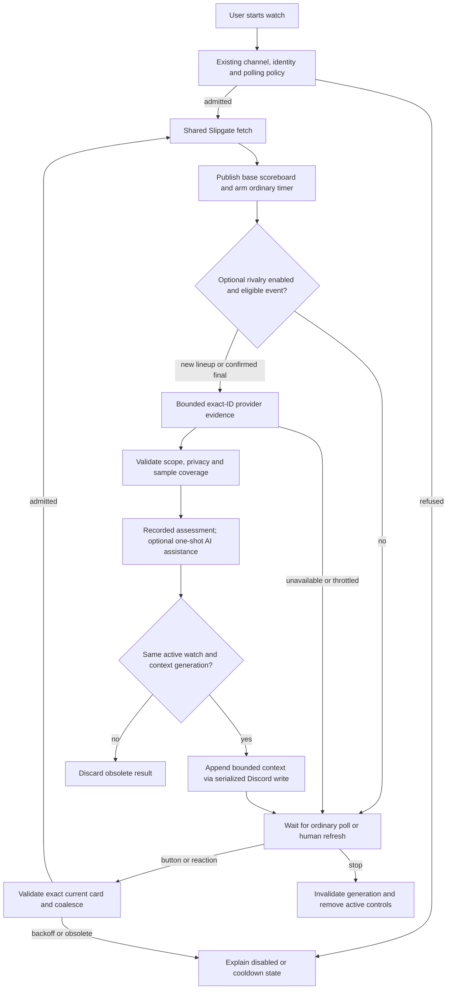

# Quake watch refresh and rivalry context

## Scope and rollout boundary

This feature adds controls to the existing Slipgate watch, public-ID gaunt reports, and optional pre-match/final context. A green PR qualifies the source for a **Solvis-only test rollout**; it does not deploy or restart Solvis or PurgeryPete. Keep the existing bot configuration and live watch state unchanged until rollout is separately approved.

Automatic rivalry enrichment is opt-in with `SLIPGATE_RIVALRY_ENABLED=true`. Leave it unset or false on other bots. Existing Slipgate authentication and polling-budget configuration are still required for watches. The opt-in does not increase the approved Slipgate request allowance. AI assistance additionally requires the existing `SLIPGATE_AI_ANALYSIS=true` configuration and a configured model provider; deterministic recorded context remains useful without AI.

## User-facing behavior

- The current mutable watch card moves below newer ordinary channel messages on its next successful refresh, even when the scoreboard is unchanged. This includes ordinary status messages from the bot itself. Retained final scoreboards are not moved or deleted.
- The active card has a labelled **🔄 Refresh** button and a 🔄 reaction. Human reaction additions and removals use the same refresh path as the button. Old cards and stopped/finalized watches cannot start another refresh.
- Concurrent refreshes coalesce with existing polling. A click does not bypass provider backoff, start a second recurring timer, or regenerate AI commentary.
- `!gaunt` and `!gaunts` are aliases. With no player arguments they summarize the current watched roster. One public roster player selects a player report; two opposing public roster players select a comparison. A unique current-roster name can resolve to its public SteamID, but provider records are joined only by exact IDs.
- `!gaunt prematch` and `!gaunt summary` select presentation modes. They do not turn warmup statistics into a confirmed result.
- Automatic pre-match context is scoped to a lineup. Confirmed final context belongs to the exact archived match, not the next warmup roster. Missing or delayed enrichment must not block publication of the ordinary scoreboard.

## What the evidence means

**Community lifetime pummels:** Purgery's recorded totals and directional victim counts. These are not current-match events, calibrated skill scores, or global ranks. The gaunt crown is limited to the matched public roster; show ties and coverage.

**Slipgate head-to-head:** mode-specific decided wins exclude draws. The API's top-level shared/teammate/opponent totals cover shared rated history across modes; do not label those totals as a mode-specific sample or as a record between historical fixed teams.

**Recent gaunts:** use only a provider response that reports the requested player, mode, ladder and match window. The documented player weapons response also contains medal aggregates. Unknown or mismatched coverage is not zero.

**Exact-match gaunts:** the verified medal code is `gauntlet`. Use a matching completed archive with the exact match GUID, server, mode, ladder and unambiguous public player identity. Do not guess a gauntlet weapon code, add medal counts to lifetime totals, or infer missing events.

Anonymous/private players and ambiguous identities are not looked up. Display names never establish cross-provider identity. Commentary must remain separate from recorded facts and must not invent positions, communication, causes, events or a warmup winner.

## Request limits and failure behavior

Purgery documents **60 requests per minute per address**, HTTP 429 with `Retry-After`, and responses cached for up to a minute. The client uses a more conservative local dispatch budget; cached/coalesced results are not extra upstream requests. Slipgate analytics reuse the existing client admission gate and its stricter configured polling budget.

A user-facing burst ceiling never overrides a lower provider limit. These admission counters are **process-local**, not a distributed fleet/IP-wide quota guarantee. Do not enable the enrichment on multiple bots sharing an address without allocating a verified combined budget or adding an independently qualified shared admission mechanism. For the initial pilot, enable enrichment only on Solvis and leave Pete's configuration untouched.

Provider failures reduce optional coverage rather than stopping the base watch. Respect the full `Retry-After`, including waits longer than one minute. Do not conceal a cached result as a newly fetched upstream result. Automatic enrichment must remain bounded and single-flight, with no independent polling timer.

## Normal operation

### Actors and boundaries

- **User:** starts/stops watches and requests reports or manual refreshes.
- **Watch manager:** owns one recurring timer, current-card identity, publication order and generation invalidation. It publishes the base card before optional historical/enrichment work.
- **Provider clients:** own fixed-host HTTP dispatch, cache, single-flight and admission/backoff. No model or provider call occurs merely because a module is imported.
- **Evidence builder:** validates exact identities, scope and null/zero distinctions. Unknown coverage remains unknown.
- **Renderer:** preserves the complete base scoreboard, adds optional context only within Discord limits, neutralizes mentions and keeps facts separate from assessment.
- **Operator:** reviews exact-head local/hosted evidence, then separately approves any Solvis-only rollout. This document grants no deployment authority.

## Solvis test handoff checklist

After a separately approved rollout, exercise these without deliberately triggering paid model work:

- Start one watch and confirm its card shows its active cadence and relative last-check time.
- Add an ordinary channel message; after the next successful update, confirm the new current card is below it and the old owned mutable card is retired.
- Click Refresh and add/remove 🔄; verify one current card, one watch, and truthful cooldown behavior. Reactions may degrade to button-only if the bot lacks Add Reactions permission.
- Try `!gaunt` and `!gaunts`, then one public player and a valid opposing pair. Verify aliases, sample coverage and lifetime-versus-match labels.
- Confirm a private/ambiguous player, an obsolete card and a stopped watch cannot trigger provider work.
- Observe a natural lineup change and a confirmed final only when available. An offline fixture pass is not an observed live match transition or a Discord-client visual check.

Retain the tested commit, target configuration changes, pre-rollout backup, health checks and rollback procedure in the deployment record. Do not describe either live bot as upgraded based solely on PR checks.
